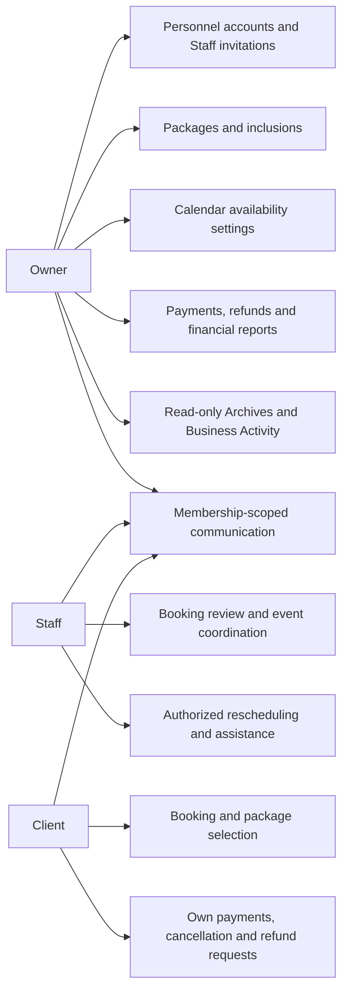

# Three-role architecture and operating guide

The active application roles are **Owner, Staff, Client**. Historical Identity/audit data may retain the former Admin name. It is not an active permission, invitation choice or login destination.

> The administrative business functions were consolidated into the Owner role to eliminate redundant responsibilities, simplify role-based access, and better align the system with the actual operational structure of Aries d' Magic Artist.

## Permission matrix

| Capability | Owner | Staff | Client |
|---|---|---|---|
| Financial dashboard, verified payment/refund decisions, financial reports | Manage | Denied | Own status/proof submission only |
| Personnel account directory, search/status filters | Authorized read | Denied | Denied |
| Staff invitations, deactivation/reactivation, session revocation, contact editing | Manage eligible Staff only | Denied | Denied |
| Owner account identity, password and verified email change | Existing self-service security workflow | Denied | Denied |
| Create/edit/archive/restore packages and inclusions | Manage | Read active packages | Public catalog / booking selection |
| Operational calendar and authorized booking details | Existing oversight | Event coordination | Own bookings/availability |
| Block/unblock dates | Manage; confirmed-event conflicts rejected | Denied | Denied |
| Maximum confirmed bookings/day | Fixed rule: 3, not editable | Fixed rule | Fixed rule |
| Booking decisions, rescheduling and event changes | Existing oversight/financial scope | Existing authorized operations | Own supported requests |
| Completed booking history | Existing read/export | Existing read | Own supported records |
| Failed-booking Archives | Read only | Denied | Denied |
| Archived package restoration | Existing Packages workflow | Denied | Denied |
| Business Activity | Read only; business events only | Denied | Denied |
| Messages and notifications | Existing membership/recipient rules | Existing membership/recipient rules | Own conversations and notifications |
| Public registration | Creates Client only | — | Client enrollment |

Owner does not obtain Staff decision rights by opening calendar settings, and never receives users' passwords or invitation secrets in the account directory. Owner/Client/multi-role/legacy identities are read-only there. No role-promotion or permanent-delete API is available. The only Owner remains protected from personnel management and legacy retirement.

## Use-case view

## Owner navigation and workflows

- The financial dashboard and its hierarchy are preserved. Existing Packages and Personnel Accounts are reused; there is no second User Management module.
- Calendar remains the operational schedule. **Calendar settings** is separate: block an unreserved date with a reason, or unblock an existing restriction. A date with a confirmed booking is refused. Coordinate through the existing authorized Staff rescheduling process first; the settings action never moves or cancels a booking.
- **Personnel accounts** lists authorized account identities with search, role and status filters. Only Staff can be invited. Invitations retain verified mailbox delivery, expiry, single-use redemption, inactive-until-enrolled state and private operator fallback. Enrolled Staff name/phone can be edited without replacing login email/password. Staff session changes remain audited and stamped.
- Legacy-only identities show **Legacy internal / Retired access** and are read-only. This display does not falsely claim the stored legacy user row has already been disabled or removed.
- **Business activity** shows business events and original actor/time/role-at-time. Raw metadata, password/authentication and technical OCR diagnostic entries are not exposed through this screen. No modification/deletion endpoint exists.
- **Archives** preserves declined/cancelled/expired records and original attribution. Missing historical timestamps remain “Not recorded”. There is no failed-booking restore or permanent deletion feature to enable. Package restoration stays in its existing, audited workflow.
- Package edits retain existing validation and immutable booking name, price, required downpayment, stored inclusion-removal names and scheduled times. The prior Staff detail display now prefers the committed package-name snapshot rather than a later catalog rename. No historical inclusion list is invented where one was never stored.

## Historical identity handling

No automatic Admin-to-Owner promotion or startup user cleanup occurs. Only three roles are initialized. `AspNetRoles`/legacy assignment rows may remain for controlled retirement and history; `AdminRemarks`, `RejectedByAdmin = 6` and historical audit JSON are retained without schema rewriting. Existing private Admin conversations remain with their original participants and senders; they are not transferred to Owner.

Legacy-only credentials cannot sign in, and a previously issued legacy-only cookie is rejected on its next authenticated request. Old Admin enrollment links cannot activate an account. Mixed legacy/active memberships retain only their already-authorized active role rights; no new role is granted.

An optional **offline**, exact-identity operator retirement command is documented separately. It uses Identity APIs, requires a usable enrolled Owner, revokes obsolete sessions/tokens through the security stamp, removes only the legacy assignment, disables a legacy-only identity, preserves a pre-existing Staff/Client membership and never deletes a user or historical role definition. It is not an HTTP/setup endpoint and is excluded from web publish output.

## Documentation and academic review

This guide is the current functional requirement/role matrix and workflow reference. Prior dated audit, deployment and test reports remain historical evidence; their old four-role descriptions must not be relabeled as current behavior. No formal research paper, original use-case diagram or defense deck is maintained as an editable source in this checkout. The separately held capstone paper and any approved requirements explicitly naming Admin need EJ/advisor review. This implementation does not silently change approved research objectives.

Update participant guides/questionnaires to use:

| Audience | Alpha task prompts | Beta evaluation prompts |
|---|---|---|
| Owner | Invite/enroll a Staff account; search/filter account statuses; edit a test package; try blocking a confirmed date; inspect Archives/Business Activity; verify a synthetic payment through the existing process | Can you complete administration without a separate Admin login? Are financial tasks still clear? Are calendar conflicts understandable? |
| Staff | Review a test booking; coordinate/reschedule through existing rules; send a client reply; confirm Owner settings are unavailable | Are coordination and client communication unchanged? Are access boundaries clear? |
| Client | Register/verify email; browse packages; request a booking; upload eligible payment proof; test supported cancellation/refund requests | Are booking/status/payment flows reliable? Are private records accessible only to authorized users? |

No questionnaire response, delivery result, accessibility certification or public launch acceptance is fabricated. Use synthetic records and the documented test environment.
